# Cut: the camera's Float

Evidence for [#113](https://github.com/jesseleechan/mockup-motion/pull/113), 26 October 2026. Before is `origin/main` at db8b456; after is this branch.

## The Shot inspector's Camera section (1440×900)

Captured with Playwright (Chromium 1194, SwiftShader) from a production build, with a picked Light or Dark theme. Scroll Story is the template with demo content; the blank project is the editor's first-run document with the gallery closed.

| Shot                  | Light, before                                 | Light, after                                 | Dark, before                                 | Dark, after                                 |
| --------------------- | --------------------------------------------- | -------------------------------------------- | -------------------------------------------- | ------------------------------------------- |
| Scroll Story (window) | 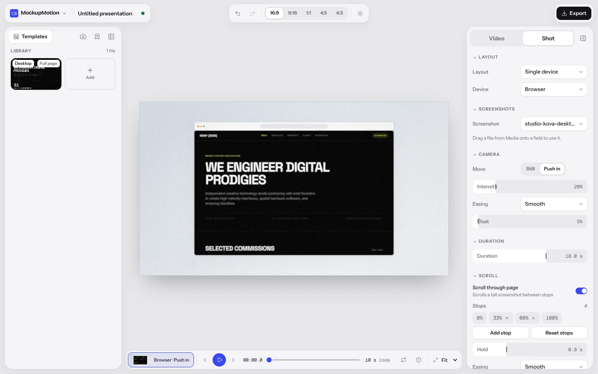  | 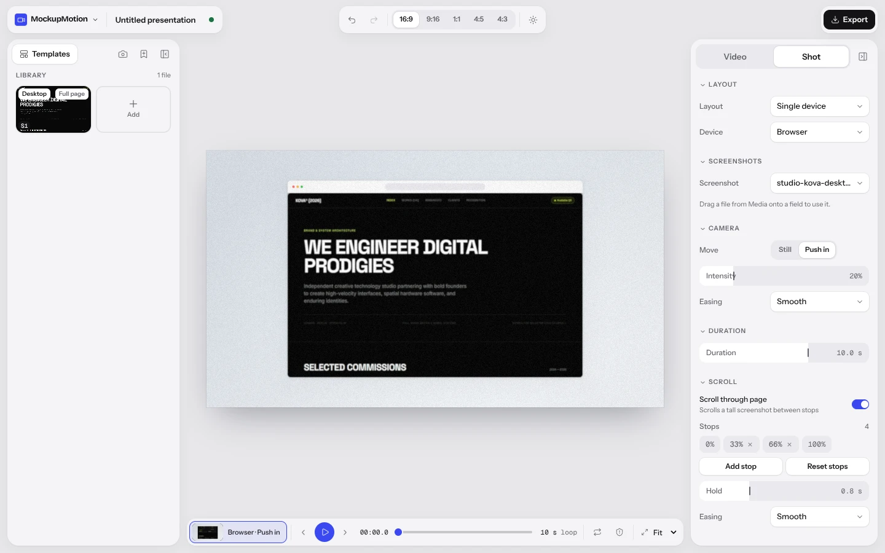  | 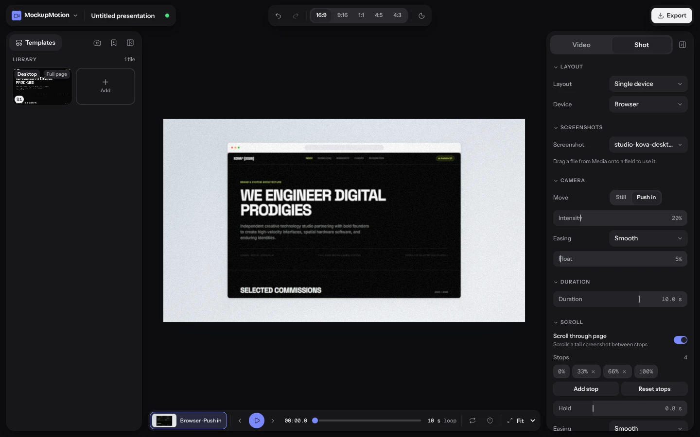  | 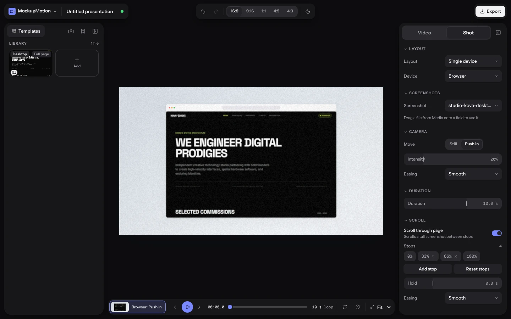  |
| Scroll Story (panel)  | 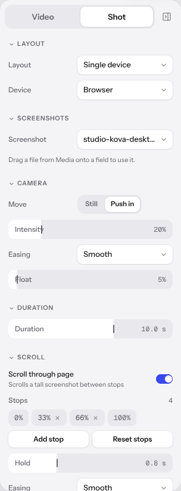 | 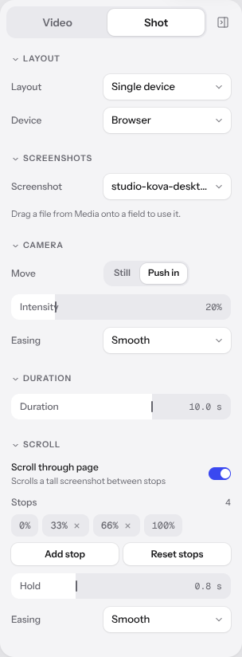 | 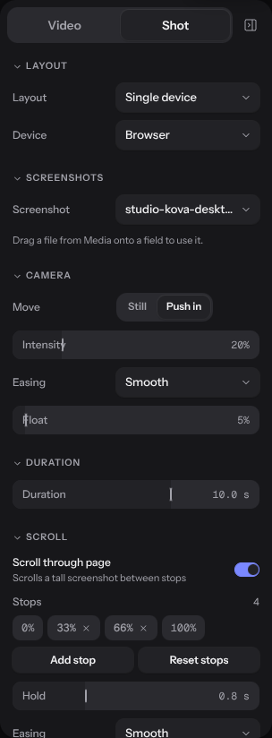 | 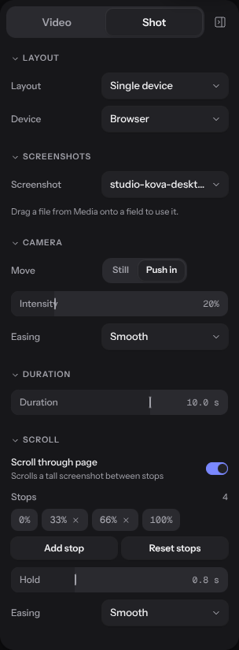 |
| Blank (window)        |          | 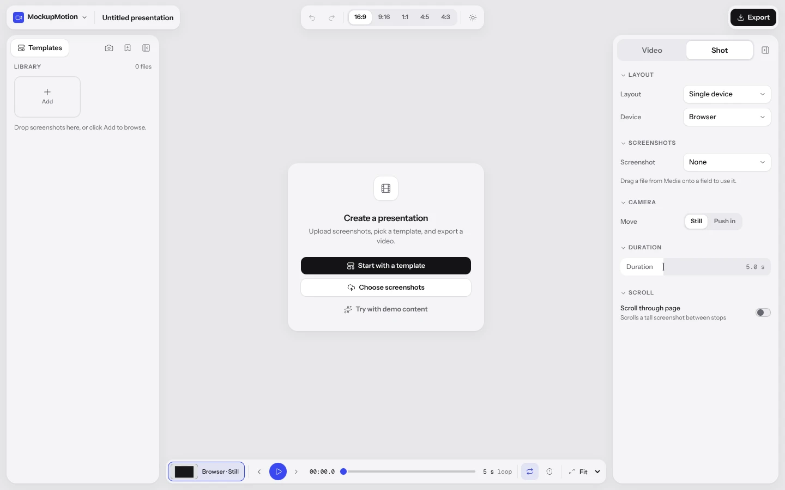         | 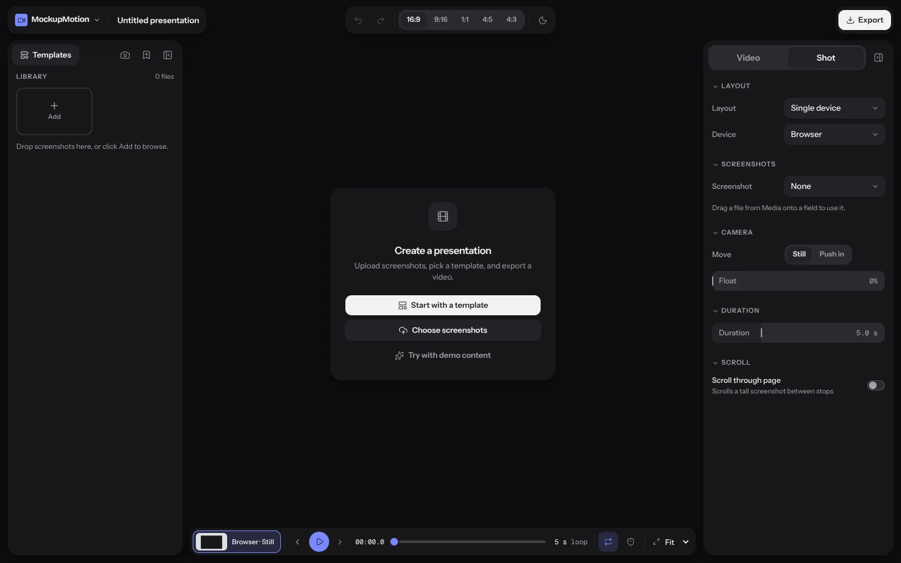         | 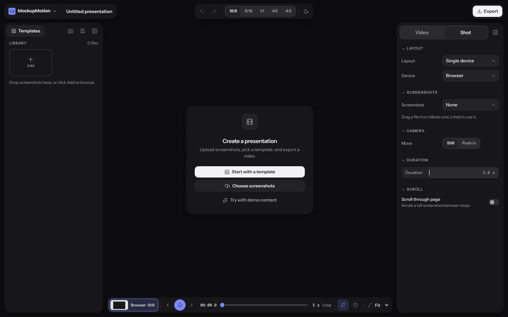         |
| Blank (panel)         | 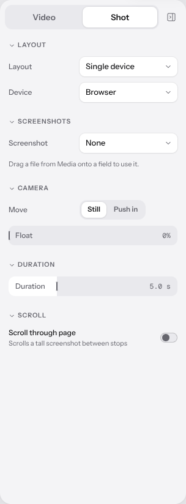        | 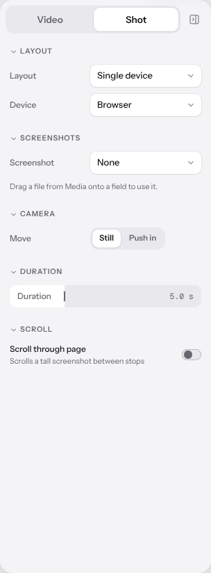        | 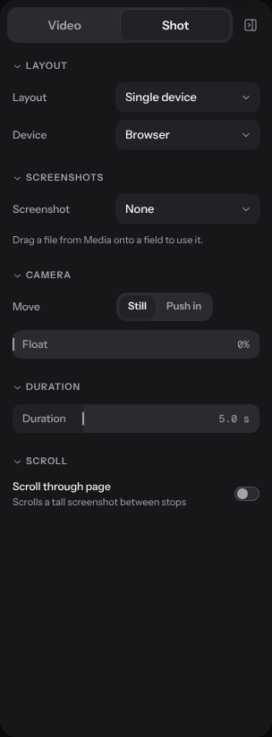        | 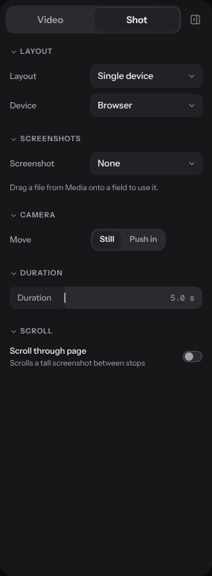        |

Scroll Story's Camera section keeps Move (Push in), Intensity (20%) and Easing (Smooth) and loses the Float slider (5%). The blank project's keeps Move (Still) and loses the Float slider (0%).

## Rendered pixels

Scroll Story and Mobile Scroll Story set Float 0.05: a sway of at most 0.06° yaw, 0.04° pitch and 0.02% distance, which moves an edge by a fraction of a pixel. No other template or still used Float.

Both renders are lossless PNGs from the same Chromium and SwiftShader. "Changed" counts pixels where any channel differs; "≤ 2 levels" is the share of those that differ by 1 or 2 of 255; "> 10 levels" counts the rest of note. "Over 0.2" counts pixels whose YIQ difference passes Playwright's default per-pixel threshold (0.2), without pixelmatch's anti-aliasing exemption, so it is an upper bound. The visual test fails a still when more than 0.2% of its pixels (460 of 230,400) pass that threshold.

**Visual stills** (as `tests/visual/stills.spec.ts` takes them):

| Still                         | Size    | Changed       | ≤ 2 levels | > 10 levels | Largest | Over 0.2 |
| ----------------------------- | ------- | ------------- | ---------- | ----------- | ------- | -------- |
| scroll-story-16x9-t0.8        | 640×360 | 11,571 (5.0%) | 84%        | 221         | 43      | 0        |
| scroll-story-16x9-t2.4        | 640×360 | 21,293 (9.2%) | 88%        | 282         | 97      | 1        |
| scroll-story-9x16-t0.8        | 360×640 | 8,731 (3.8%)  | 68%        | 274         | 47      | 0        |
| scroll-story-9x16-t2.4        | 360×640 | 9,813 (4.3%)  | 88%        | 31          | 35      | 0        |
| mobile-scroll-story-16x9-t0.8 | 640×360 | 4,104 (1.8%)  | 99%        | 19          | 67      | 2        |
| mobile-scroll-story-16x9-t2.4 | 640×360 | 2,618 (1.1%)  | 82%        | 187         | 67      | 2        |
| mobile-scroll-story-9x16-t0.8 | 360×640 | 18,383 (8.0%) | 95%        | 38          | 63      | 5        |
| mobile-scroll-story-9x16-t2.4 | 360×640 | 7,235 (3.1%)  | 90%        | 220         | 72      | 11       |

`npm run test:visual` passes all 64 stills against the committed Linux baselines, none updated.

**Contact-sheet frames** (as `npm run contact-sheet` renders them, 960 px wide, at 15%, 50% and 85% of the shot):

| Frame                        | Size     | Changed        | ≤ 2 levels | > 10 levels | Largest | Over 0.2 |
| ---------------------------- | -------- | -------------- | ---------- | ----------- | ------- | -------- |
| scroll-story 16:9 15%        | 960×540  | 31,014 (6.0%)  | 73%        | 530         | 100     | 1        |
| scroll-story 16:9 85%        | 960×540  | 25,866 (5.0%)  | 69%        | 896         | 100     | 1        |
| scroll-story 9:16 15%        | 960×1708 | 44,561 (2.7%)  | 71%        | 2,583       | 48      | 0        |
| scroll-story 9:16 85%        | 960×1708 | 32,247 (2.0%)  | 64%        | 838         | 101     | 3        |
| scroll-story 1:1 15%         | 960×960  | 54,184 (5.9%)  | 68%        | 3,802       | 101     | 1        |
| scroll-story 1:1 85%         | 960×960  | 34,369 (3.7%)  | 64%        | 1,457       | 99      | 1        |
| mobile-scroll-story 16:9 15% | 960×540  | 12,169 (2.3%)  | 95%        | 42          | 63      | 2        |
| mobile-scroll-story 16:9 85% | 960×540  | 12,585 (2.4%)  | 81%        | 506         | 67      | 8        |
| mobile-scroll-story 9:16 15% | 960×1708 | 146,116 (8.9%) | 80%        | 6,253       | 99      | 87       |
| mobile-scroll-story 9:16 85% | 960×1708 | 94,630 (5.8%)  | 77%        | 3,164       | 99      | 82       |
| mobile-scroll-story 1:1 15%  | 960×960  | 56,115 (6.1%)  | 79%        | 1,674       | 91      | 450      |
| mobile-scroll-story 1:1 85%  | 960×960  | 34,018 (3.7%)  | 74%        | 652         | 96      | 19       |
| every 50% frame (6)          |          | 0              |            |             | 0       | 0        |

The 50% frames are identical because the sway is a sine over the shot and is zero at its middle. That also shows the renders are deterministic, so every difference above is the sway.

**One frame, close up:** Scroll Story at 16:9, 1.5 s (15%), the headline, 4× with nearest-neighbour scaling. Before, after, and the changed pixels in red (the full frame's map is `pixels-scroll-story-16x9-t15-diff.webp`):

| Before                                             | After                                             | Changed pixels                                   |
| -------------------------------------------------- | ------------------------------------------------- | ------------------------------------------------ |
|  | 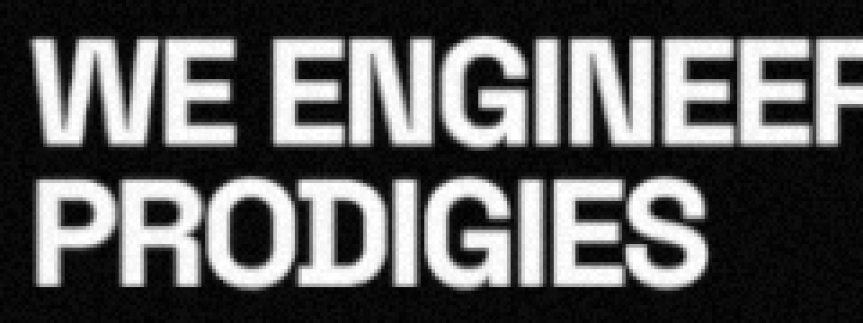 | 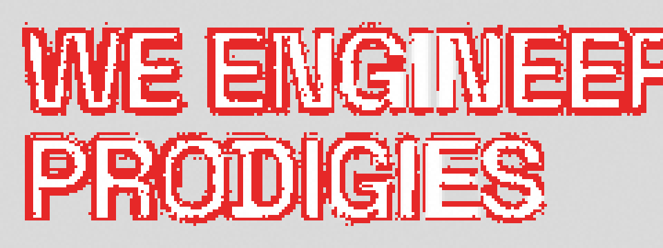 |

The changes sit on edges (text, the window frame, the shadow's falloff), where a sub-pixel shift resamples the texture. Nothing moves by a visible amount, so the gallery's preview videos in `public/templates` are left as they are.
