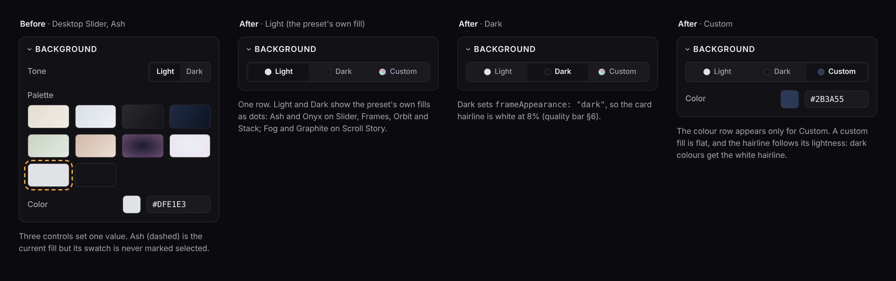

# Polish: the Video and Shot inspectors

From the editor audit of 19 October 2026, approved by the owner. Five items, one PR each. CLAUDE.md, fix plan §3, `contracts.md` and `quality-bar.md` apply to all of them.

Decisions (owner, 19 October 2026, via the coordinating session): the P1 proposal as written; Scroll Story's dark fill is Graphite; P2 to P4 as planned; P5 added.

Polish what remains after the cuts, not what is being deleted. Each PR is built as a draft stacked on the cut branch it needs, and retargeted to `main` once that cut merges.

| #   | Item                           | Waits for                                                                        | Status      |
| --- | ------------------------------ | -------------------------------------------------------------------------------- | ----------- |
| P1  | One background control         | Backgrounds cut (#64), chrome/finishes and camera-moves cuts, typography cut     | Merged: #82 |
| P2  | Show only what applies         | Same as P1                                                                       | Merged: #96 |
| P3  | The screenshot list            | Cursor cut (#62), typography cut, camera-moves cut, layouts and reels cuts (#61) | Merged: #89 |
| P4  | Hide sections that can't apply | Same as P3                                                                       | Merged: #97 |
| P5  | One pace control               | Stack (#53 to #57), Responsive Scroll (#58, #59), reels cut (#74)                | Merged: #98 |

## P1. One background control

Today Video inspector > Background has three controls that set one value: a Tone switch (only on presets with `toneSwitch`), a 10-swatch palette and a colour field. The palette never marks the solid Ash or Onyx as selected (`currentPalette` matches gradients only; listed in `follow-ups.md`).

**Decided.** One segmented control: **Light**, **Dark**, **Custom**. Each option shows a dot of its fill. The colour row appears only when Custom is selected.

- **Light and Dark are the preset's own fills.** A template declares them (`tones: { light, dark }`, palette ids, replacing the `toneSwitch` flag). Slider, Frames, Orbit and Stack: Ash and Onyx. Scroll Story: Fog and, as its dark fill, Graphite (the Fog-matching gradient; Onyx is Graphite's first stop). A document with no template uses Ash and Onyx.
- **Custom** sets a flat solid from the colour field. Choosing Custom starts from the current fill's colour, so nothing jumps.
- **Hairline (quality bar §6).** Light and Dark take the palette's `frameAppearance`, so Dark gets the white 8% card hairline. A custom colour sets `frameAppearance` from its OKLCH lightness: below 0.5 is `"dark"` (white hairline), otherwise `"light"`.
- **What is selected.** Light or Dark when the background equals that fill (case-insensitive, gradients by stops and angle); Custom otherwise. That also fixes the `currentPalette` follow-up, since the palette grid goes.
- **Re-applying a preset** keeps a dark document dark: when `frameAppearance` is dark (a preset's Dark or a dark custom colour), the new preset builds its own Dark fill. Otherwise it builds its Light.
- **Saved projects** load unchanged. A project on Bone, Sage or another removed swatch shows as Custom with its first stop; its gradient stays until the user picks something.
- **Grain and vignette** are not part of this control (P2 decides where they show).

Tests: unit tests for the tone read-out and the custom hairline rule in `src/templates/looks.ts`, and the existing store-level undo test. The e2e selectors that click palette swatches move to the segmented control; no new e2e test. No still changes: the fills are the same values.

## P2. Show only what applies

After the cuts, "Frame and effects" shows:

- **Shadow:** always.
- **Browser chrome and URL:** only when a shot uses a browser; URL only when the chrome shows an address bar.
- **Grain and vignette:** only when the background can band, that is a gradient. A flat fill cannot band (quality bar §6), so the presets' Ash and Onyx hide them. If a saved flat-fill project has grain or vignette above 0, the sliders stay visible so it can be turned off.
- Device finish: removed by the finishes cut; nothing to do here if it lands first.

A section with no visible control is not rendered. Unit test the visibility rules as a pure function (`frameEffectsFor(doc)`), not in e2e.

## P3. The screenshot list

`SliderScreenshots.tsx` lists file names with a remove button, an "Add screenshot" select and a drop target for files dragged from Media. It has no reordering. It serves the slider and orbit; Stack and Frames get the same list.

- Each row: drag handle, a 40 × 26 thumbnail (object-fit cover, top-aligned, from the asset's object URL), the name (truncated, full name in the tooltip), remove.
- Drag to reorder with pointer events, plus Alt+↑ / Alt+↓ on a focused row for keyboard users. Reorder is one undo step (`reorderShotAsset` in the store).
- "Add screenshot" becomes a button that opens a menu of library screenshots with thumbnails, and "Upload…" at the end.
- Frames fills lanes from the project's screenshots; the list there edits the same order.

Tests: unit tests for the store's reorder (order, undo, out-of-range). One e2e test at most, for drag reordering, if the drag is the part that has broken before; otherwise none.

## P4. Hide sections that can't apply

- **Entrance and duration** on a looping preset shows a disabled Duration slider and an Entrance select, each with a note. Hide both. Show the loop length as a read-out ("Loop 12.0 s") in the Screenshots section header or under the list.
- **Camera** after the moves cut is Still or Push in, plus intensity. Keep the section only where a shot has a camera (Scroll Story); drop easing and float if the cut leaves them with nothing to choose, and drop the section where the preset has a still camera.
  - **Float, decided 26 October 2026: cut** ([#FLOATPR](https://github.com/jesseleechan/mockup-motion/pull/FLOATPR)). Float stayed open after the moves cut (#76). The owner left it to the coordinator ("whatever you recommend"), who recommended cutting it: it was the one exception to "no back-and-forth motion" (quality bar §2.4), Push in already gives a still shot its motion, and the two Scroll Stories used it at 0.05, a sway nobody could see. The Camera section is the Still / Push in control, with intensity and easing for Push in. Easing stays: it still has four curves to choose from.

Tests: unit tests for the visibility rules. Update e2e selectors that read the removed notes.

## P5. One pace control

From the audit's "Add" list. **Calm, Default and Brisk**, shared by every preset, in the Shot inspector. It replaces the step-length slider on the sliders and the loop-length chips on Frames, and covers Stack, Orbit and Responsive Scroll.

- **Default** keeps today's timing exactly, so no still changes.
- **Calm ×1.2 and Brisk ×0.8 on time**, the same pair for every preset. ×1.2 rather than ×1.25 keeps every Calm value inside an existing range (the slider step and the Responsive hold) without clamping. Values are rounded, then clamped by the existing limits:

  | Preset               | Knob            | Brisk         | Default | Calm  | Limits                                                             |
  | -------------------- | --------------- | ------------- | ------- | ----- | ------------------------------------------------------------------ |
  | Slider, Stack, Orbit | `layout.step`   | 1.6 s         | 2.0 s   | 2.4 s | 1.6–4.0 s and N × step ≤ 30 s (shown N)                            |
  | Frames               | `shot.duration` | Default × 0.8 | today's | × 1.2 | speed ≤ 0.20 stage units/s (`framesDuration`), ≤ 30 s, 0.5 s steps |
  | Responsive Scroll    | `scroll.hold`   | 0.8 s         | 1.0 s   | 1.2 s | moves already run at the scroll speed limit, so they stay          |

- **Where a limit makes two paces equal, the UI says so.** Frames is often already at its speed limit, so Brisk equals Default with 5 or 6 screenshots in most aspects. A slider with 15 or more screenshots can't be calmer within 30 s. The equal option is disabled with its reason ("Already at the speed limit"), the way the loop-length chips do today.
- **Stored, not derived.** An optional `Shot.pace?: "calm" | "brisk"` (absent is Default; no version bump). The timing fields become outputs: `sanitizeDoc` and the store's shot fitting recompute `step`, `duration` or `hold` from the pace, so a choice survives a clamp that is later lifted (an aspect change, adding or removing screenshots).
- **Saved projects:** a shot without `pace` gets the nearest one once, on load (ties go to Default). Saved 20 s and 30 s Frames loops become Calm.
- **Scroll Story** isn't covered: it doesn't loop and its duration is free to edit. It goes to `follow-ups.md`.
- **Code:** a pure `src/motion/pace.ts` (`paceTargets`, `nearestPace`, `applyPace`, `paceLimited`); a `PaceSection` segmented control in the Shot inspector replacing the step slider, `LoopLengthChips` and Responsive Scroll's Hold slider. Fixes on the way: the step clamp uses the shown screenshot count (an orbit with more than 6 screenshots is under-capped today).
- **Tests:** `tests/pace.test.ts`. Every registry template at all five aspects: Default equals today's build, Calm and Brisk match the table, Frames stays under its speed limit and 30 s. Nearest-pace mapping on load. A choice survives an aspect round trip and removing screenshots. Loops stay seamless at every pace. Existing e2e specs that use "Step length" or the loop chips move to the pace control; no new e2e test.

## Evidence for every PR

Before and after screenshots of the editor at 1440 × 900 and 1280 × 800, and `tests/e2e/ui-overflow.spec.ts` passing. The owner approves each PR's look before it merges.

## Follow-ups

None yet.
