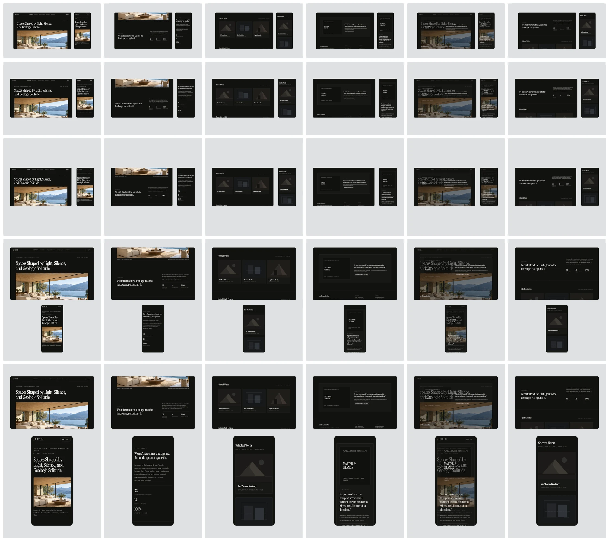

# R04 evidence: Responsive Scroll rendering

Lab fixtures `responsive-scroll` (Aurelia's desktop and mobile full pages with their capture sections; since R05 the template's own preview, which renders identically) and `responsive-scroll-fallback` (the same pages without sections, `src/lab/responsive-fixtures.ts`). Stills from `/lab?still=1&fixture=…&aspect=…&t=…&w=1200` (Chromium, SwiftShader), checked by eye.

Rows: 16:9, 4:3, 1:1, 4:5, 9:16. Columns:

1. t = 0.5 s, top hold: both screens show the top of the page (header and hero).
2. t = 2.05 s, mid-move (top → works): both screens between sections, moving together.
3. t = 3.6 s, works hold: both screens have "Selected Works" at the top of the screen.
4. t = 8.45 s, monograph hold: both screens have the "Matter & Silence" monograph section at the top.
5. t = 8.9 s, the wrap crossfade (8.58–9.38 s of the 9.38 s loop): the monograph frame dissolving into the top of the page. This is the loop's seam, inside the last hold.
6. Fallback, t = 3.6 s: no section data, so each screen stops at the same fraction of its own page and they show different sections. That is expected (decision D5).

Checked against `quality-bar.md`:

- §3.1 Fit to width: no screenshot is cropped horizontally; overflow scrolls at the bottom. The screens show the source colours on flat cards (no tint, no faded neighbours).
- §3.4 Cards: hairline border, landscape radius on the desktop card, 7.5% radius on the portrait card.
- §4 Responsive Scroll: side by side at 16:9, 4:3 and 1:1, stacked at 4:5 and 9:16, the pair centred inside the 7% safe margin.
- §5 and §6: Ash background, no shadow, grain 0, vignette 0.
- §2.5: one move (the scroll), still camera, no reversal.

`works-hold_<aspect>.webp` are the column-3 stills at full width.

## Rendering test

`tests/e2e/responsive-scroll.spec.ts`, "Responsive Scroll: rendering (R04)", 16:9 and 4:5: both card interiors show screenshot content (luminance spread > 8) at t = 0.5 s and at t = 3.6 s, and more than 10% of their pixels change between the two (the screens scrolled).

- Fails with the `evaluate` scroll wiring removed: 2 failed (changed fraction: expected > 0.1, received 0).
