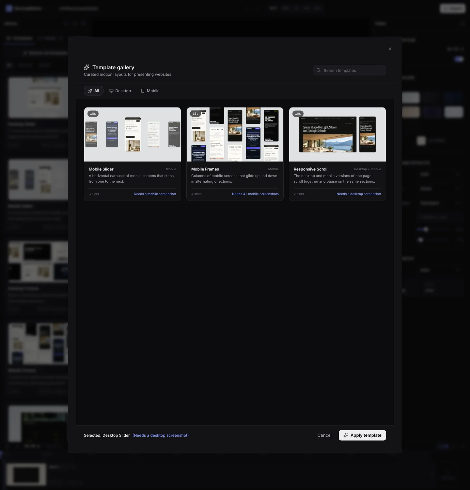
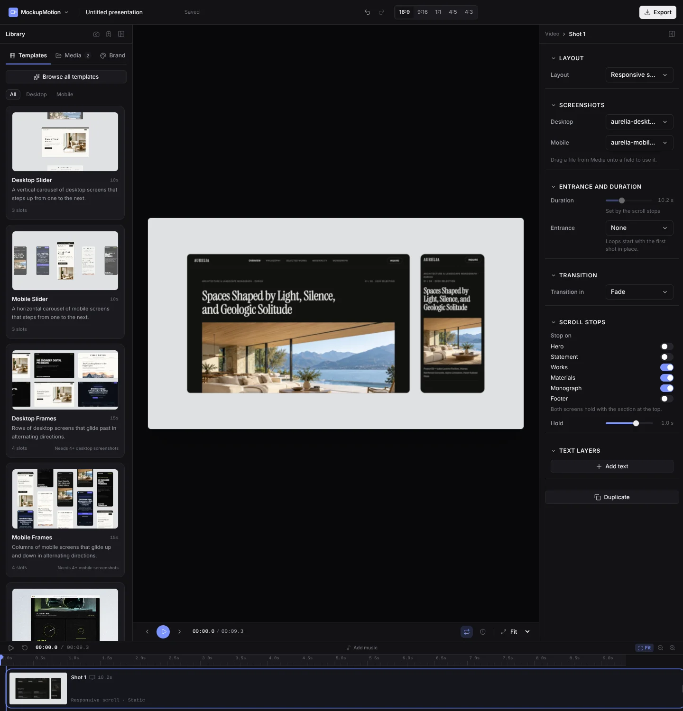
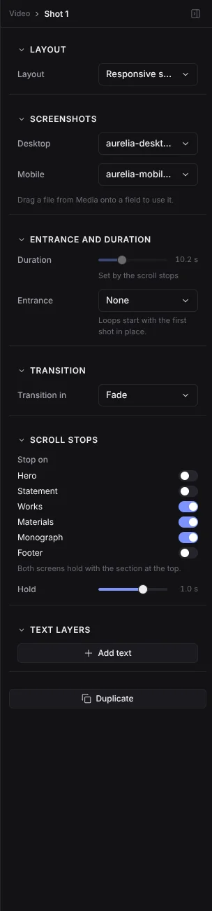

# R05 evidence: Responsive Scroll template

## Gallery (D1)

The Mobile tab shows Responsive Scroll next to Mobile Slider and Mobile Frames, with the chip "Desktop + mobile". The Desktop tab shows it after Scroll Story, and All shows it last. The poster is the first hold, with Aurelia's hero on both screens (`scripts/template-previews.ts` takes it at 5% of the loop; the usual 35% frame is Aurelia's dark works section, which compressed below the 15 KB placeholder floor).

## Editor

Applied with demo content: Aurelia's desktop and mobile full pages as flat cards on Ash. The loop is 9.4 s; the shot is 10.2 s, including the 0.8 s wrap crossfade. The Camera section is hidden (still camera), and the duration is "Set by the scroll stops".

Scroll stops: the shared sections minus the header (the top is always the first stop), with Works, Materials and Monograph on by default, the hint, and Hold (0.6–1.2 s, quality bar §2.2). Without section data the section shows "Add the capture's JSON file to stop on sections."; with section data that shares nothing it shows "These pages share no sections, so stops are spaced evenly."

## Tests

- `tests/responsive-scroll-template.test.ts` (8): gallery tabs, the built document (Ash, no shadow, grain 0, vignette 0, still camera, fade wrap, 10.18 s), requirements, page names, slot pairing by capture URL and by file name, the fallback, and keeping the user's assignment.
  - With the same-page step disabled: 2 failed (both pairing tests).
- No e2e tests for the preset (CLAUDE.md, Tests, 19 October 2026: a new preset adds none; the existing specs that cover every built-in template exercise it). Two template e2e tests written for this task (gallery tabs; apply with demo content and toggle a stop) were removed under that rule; `tests/responsive-scroll-template.test.ts` covers the tabs, and `tests/responsive-scroll.test.ts` the stops and duration.
- Shared tests read the template list from the registry instead of a literal count: `tests/templates.test.ts` (uniqueness; the gallery order list pins the set), `tests/template-previews.test.ts` (the count-only test is gone; the preview files are compared to the registry), and the e2e specs `assets`, `first-run`, `thumbnails` and `wave5` (counts, gallery order and tab contents from `BUILTIN_TEMPLATES` and `templateInCategory`). `tests/preset-tone.test.ts` and `tests/sections.test.ts` list Responsive Scroll by id.
