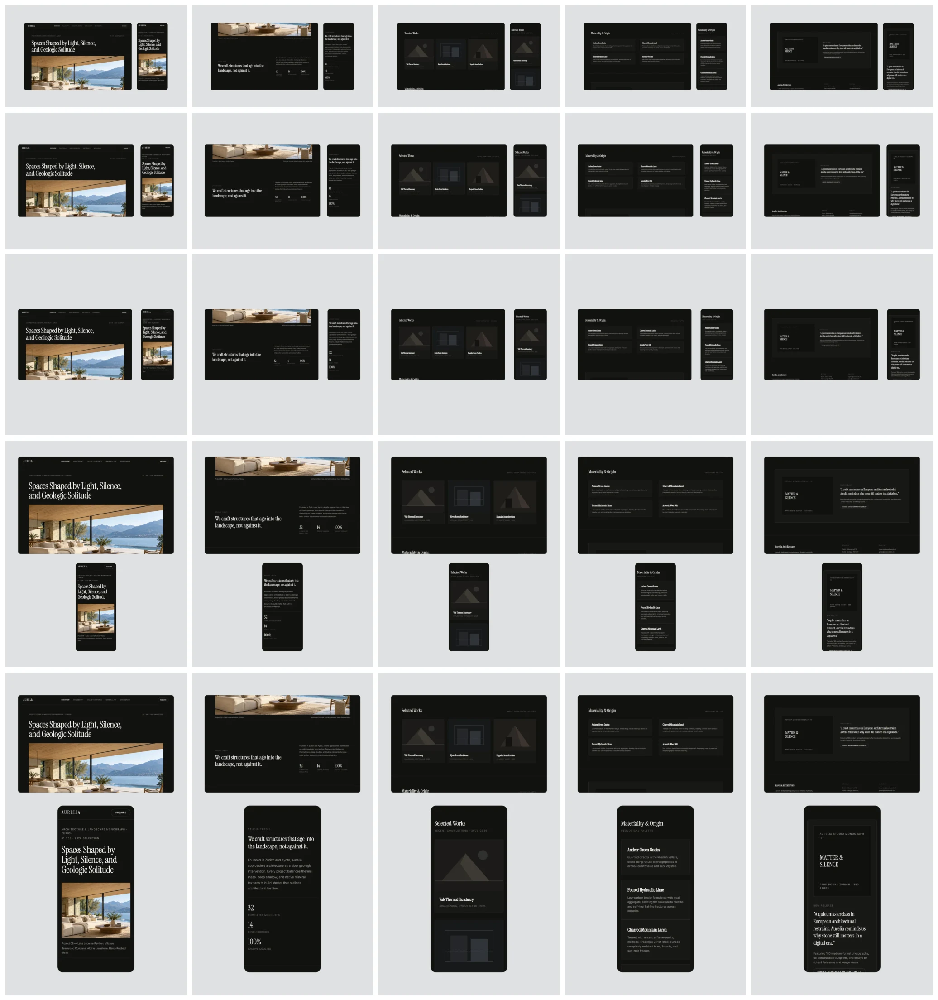

# R06: owner review and visual baselines

**Status: waiting for the owner's review.** No visual baselines are committed until the owner approves the rendered stills in writing (`tests/visual/README.md`).

## Contact sheet

`npm run contact-sheet -- --templates responsive-scroll --aspects 16:9,4:3,1:1,4:5,9:16 --times 0.5,2.05,3.6,6.4,8.45 --out …` renders through the export path. The frames are in `sheet/`, and `sheet/index.html` shows them at full size.

Rows are 16:9, 4:3, 1:1, 4:5 and 9:16. Columns are times in the 9.4 s loop:

| Time   | What both screens show                            |
| ------ | ------------------------------------------------- |
| 0.5 s  | Top hold: Aurelia's hero                          |
| 2.05 s | Moving, top → works                               |
| 3.6 s  | Works hold: "Selected Works" at the top           |
| 6.4 s  | Materials hold: "Materiality & Origin" at the top |
| 8.45 s | Monograph hold: "Matter & Silence" at the top     |

The wrap crossfade runs 8.58–9.38 s (R04 contact sheet, column 5).

## Baselines proposed (after approval)

Six stills in `tests/visual/stills.spec.ts`, rendered by the Visual baselines workflow on the CI runner:

- `responsive-scroll-<aspect>-t3.6`: the works hold at 16:9, 4:3, 1:1, 4:5 and 9:16. These pin the card geometry per aspect and both screens on the same section.
- `responsive-scroll-16x9-t2.05`: mid-move. This pins the shared timing.

## Open question for the owner

The last stop is held for 1.0 s, and the wrap crossfade takes the last 0.8 s of that hold. So the monograph frame shows on its own for 0.2 s before it starts dissolving into the top. The alternative is a full 1.0 s on its own before the fade, which makes the loop 10.2 s (shot 11.0 s).
