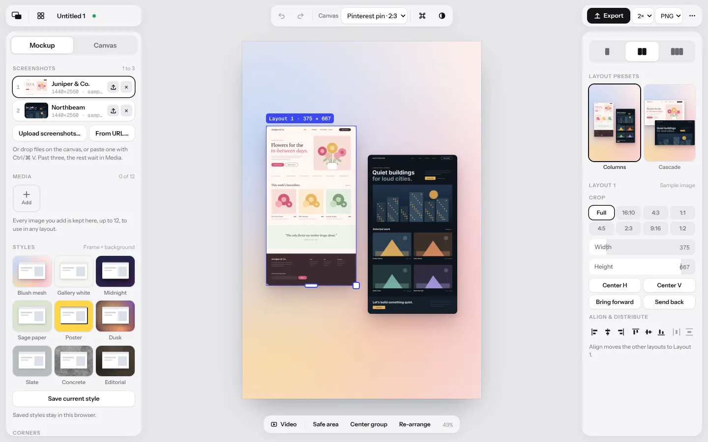
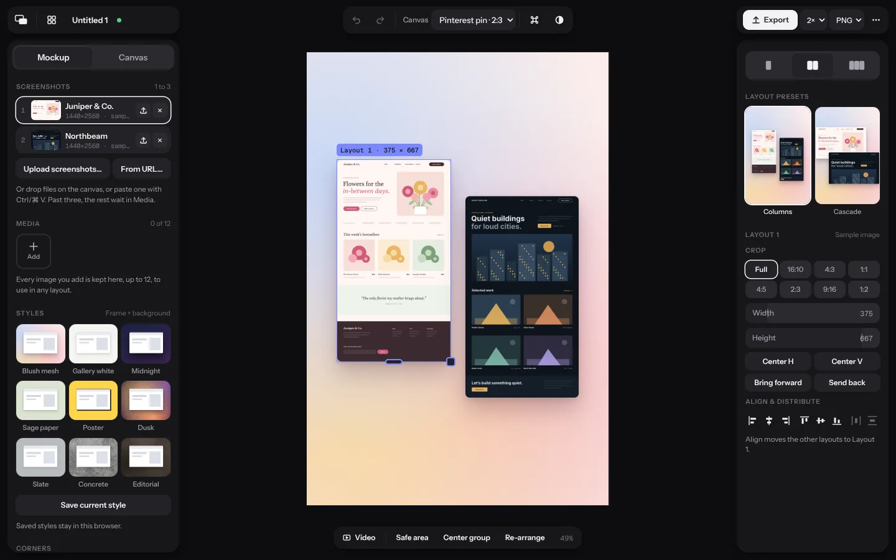
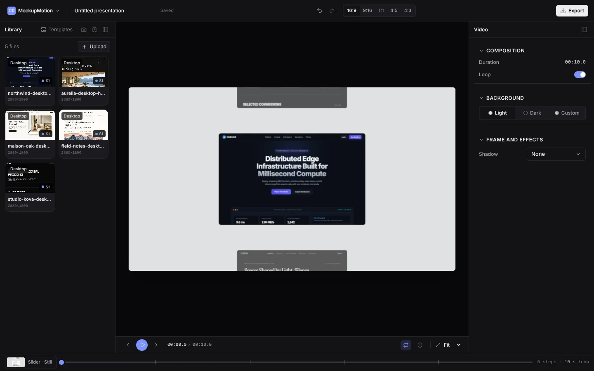

# Restyle: the editor in Layout Stage's look

The owner asked on 25 October 2026 for MockupMotion's editor to look more like [Layout Stage](https://github.com/jesseleechan/layout-stage), whose editor follows Shots (shots.so). Four items, one PR each. CLAUDE.md and fix plan §3 apply to all of them.

**Decisions (owner, 25 October 2026):**

- **Restyle and shell, not a re-layout.** Adopt Layout Stage's look:
  - floating rounded panels on a quiet workspace;
  - three floating clusters in place of the top bar;
  - a floating toolbar under the canvas;
  - its fonts and its controls.

  Keep where things live: the Library on the left, the inspector on the right, transport and timeline under the stage.

- **The theme follows the system.** Light or dark comes from the OS setting, with a System → Light → Dark toggle, as in Layout Stage. Today the editor always opens dark.

| #   | Item                       | Waits for | Status                                                                     |
| --- | -------------------------- | --------- | -------------------------------------------------------------------------- |
| R1  | Tokens, fonts and theme    | Nothing   | In review ([#107](https://github.com/jesseleechan/mockup-motion/pull/107)) |
| R2  | The shell: floating panels | R1        | In review ([#108](https://github.com/jesseleechan/mockup-motion/pull/108)) |
| R3  | Controls (`src/ui`)        | R1        | Not started                                                                |
| R4  | Panels and dialogs         | R2 and R3 | Not started                                                                |

R2 and R3 touch different files (`src/editor/shell`, `EditorShell.tsx` and the stage frame; `src/ui`), so they can run in parallel once R1 merges.

## Reference

| Layout Stage, light                      | Layout Stage, dark                     | MockupMotion today                 |
| ---------------------------------------- | -------------------------------------- | ---------------------------------- |
|  |  |  |

The source of truth for values is Layout Stage's `app/globals.css` and `components/*.css` (the repository is public). Its traits:

- **Workspace:** a grey workspace (`#E7E7EA` light, `#0C0C0E` dark) with 10–12 px gaps. Panels float on it at radius 18 with a soft two-layer shadow (`--lift`). No borders divide the window.
- **Top clusters:** three 44 px clusters at radius 14, on the left, centre and right, instead of one bar.
- **Controls on panels:** controls sit on _paper_ (white in light), and tracks and fields are _field_ (`#E9E9ED`). Every choice is a pill, chip, tile or segment.
- **Pill slider:** the whole 32 px pill is the track, filled with paper up to the value. The label sits inside on the left and the value on the right.
- **Segmented control:** a white pill slides over a soft track.
- **Section headings:** uppercase 10.5 px, letter-spacing 0.08 em, with an optional note on the right.
- **Primary button:** the primary action is ink (near-black in light, white in dark), not the accent. The accent (`#3A48F0` light, `#7A88FF` dark) marks focus and selection.
- **Type:** Instrument Sans for the UI (13 px body), Geist Mono for numbers, Bricolage Grotesque 700 for the wordmark.

## Rules for every item

- **No rendered pixel changes.** This is editor chrome only, and the visual stills must pass unchanged. **Inter stays** for the browser URL pill drawn into videos (`quality-bar.md` §3.2, `src/text/rasterize.ts`); only the UI's font changes.
- **Keep accessible names and roles.** e2e specs find controls by role and name. Restyle the controls; don't rename them. If a name must change, update the spec in the same PR.
- **Overflow guard:** `tests/e2e/ui-overflow.spec.ts` stays green at every viewport, in both themes.
- **Contrast:** text that carries meaning keeps at least 4.5:1, as WP-05 requires. Layout Stage sets section headings in `--ink-3` (about 2.6:1 on the panel); use the `--ink-2` value for them instead.
- **Evidence:** each PR shows the editor before and after at 1440 × 900 and 1280 × 800, in light and dark, under `docs/restyle-plan/evidence/<item>/`.
- **Self-hosted fonts:** fonts come from `@fontsource` packages, never a font CDN. The editor is local-first.
- **Tests:** none needed beyond what the item breaks. A restyle adds no e2e test. A unit test is right only for logic, such as the theme preference.

## R1. Tokens, fonts and theme

Today, `src/ui/theme.css` has dark under `:root` and light under `[data-theme="light"]`, and `EditorShell.tsx` sets `data-theme="dark"` when nothing is saved.

- **Tokens:** take Layout Stage's palette for both themes (`--bg`, `--panel`, `--paper`, `--field`, `--field-2`, `--ink`, `--ink-2`, `--ink-3`, `--line`, `--line-strong`, `--accent`, `--accent-soft`, `--scrim`, `--lift`, `--lift-sm`).
  - Map them onto MockupMotion's token names, so existing Tailwind classes keep working.
  - Add the names that have no counterpart: paper, field, field-2, and the two shadows.
- **Theme:** light under `:root`, dark under `@media (prefers-color-scheme: dark) { :root:not([data-theme="light"]) }` and again under `:root[data-theme="dark"]`, as Layout Stage does.
  - The toggle cycles System → Light → Dark, and the choice is kept in localStorage.
  - A small inline script in `index.html` applies a saved Light or Dark before first paint, so the page never flashes the wrong theme. System sets no attribute.
- **Fonts:**
  - Instrument Sans (400, 500 and 600) for the UI.
  - Geist Mono (400 and 500) for timecodes, durations, sizes and slider values.
  - Bricolage Grotesque 700 for the MockupMotion wordmark.
  - `@fontsource-variable/inter` stays, for the URL pill.
- **Buttons:** the primary button becomes ink on paper (Export, Apply template, Start export). The accent stays for focus rings, the selection, the playhead and toggles that are on.
- No layout changes in R1.

## R2. The shell: floating panels

- **Workspace:** the window is `--bg`, padded 10–12 px, with 10–12 px gaps between regions. The Library and the inspector float at radius 18 with `--lift`. Remove the borders between regions.
- **Top bar to three clusters**, each a 44 px pill at radius 14:
  - **Left:** wordmark and app menu, the project name and its saved state, shown as a small dot with an accessible label.
  - **Centre:** undo and redo, aspect, theme toggle.
  - **Right:** Export (primary) and the more menu.
- **Stage:** the canvas sits on the workspace with a soft shadow. Drop the darker stage frame (`--color-stage`), so letterboxing is workspace colour.
- **One floating toolbar under the canvas:** transport and the slim timeline (#79, #88) become one pill at radius 14. It holds:
  - the shot button;
  - previous, play and next;
  - the timecode;
  - the scrubber with its step ticks;
  - the loop length;
  - loop and safe margins;
  - zoom.

  It keeps every control and shortcut it has today.

- **Collapse and resize:**
  - A collapsed side panel leaves a slim floating rail.
  - Panels stay resizable: the drag handle sits in the gap.
  - The Library still collapses below 1280 px, and the stage keeps at least 480 px (#78).

## R3. Controls (`src/ui`)

- **Button:**
  - variants: primary (ink), secondary (paper with `--lift-sm`) and ghost;
  - sizes 32, 28 and 24 px, at radius 10, 9 and 7;
  - icon buttons are 36 px at radius 10.
- **SegmentedControl:** a field track at radius 12 with padding 3, and a paper pill at radius 9 with `--lift-sm`. Tabs use the same look.
- **Slider:** the pill slider described above. Keyboard steps, scrubbing (`scrub.ts`) and the Field row keep their behaviour. A Field that pairs a label with a slider becomes one pill row.
- **Fields:**
  - Select and number fields: paper, `--lift-sm`, radius 9, 32 px.
  - Switch: on is accent.
  - ColorField: a colour row (label on the left; the swatch and hex on the right).
- **Section:** uppercase 10.5 px headings (see the contrast rule) with an optional right-aligned note. Sections keep collapsing.
- **Menus and overlays:**
  - Popover, DropdownMenu and ContextMenu: paper, radius 10, 30 px items, Layout Stage's menu shadow.
  - Tooltip, Toast and ProgressBar: the same surfaces.
  - Dialog: a panel at radius 18 over `--scrim`.

**For R4 (added in R3).** Every existing prop still works; these are new:

- `SliderRow`: the pill row with its label and value inside. It replaces a `Field` around a `Slider` in one line: `<SliderRow label="Grain" output="25%" value={v} onChange={set} />`. Keep `aria-label` only where the name differs from the label ("Hold" reads as "Hold at each stop"). `output` defaults to the value at the step's precision (`formatStepValue`).
- `ColorField` with `label`: the 36 px colour row, replacing `<Field label="Color"><ColorField/></Field>`.
- `Section` with `note`: a short note on the right of the heading.
- `Chip` with `pressed` (`aria-pressed`): Layout Stage's 28 px chip, e.g. for the scroll stops.
- `Input` with `numeric`: a 32 px paper field (the URL field, search, numbers).
- `Button` size `xs` (24 px) and `IconButton` sizes `lg` (36 px, the clusters) and `xs`.
- `Tabs` now look like the segmented control, for the inspector's Video and Shot tab.

## R4. Panels and dialogs

- **Library:**
  - Media become square tiles, as in Layout Stage's media grid, keeping the role badge and the full name on hover (#94).
  - Upload becomes an "Add" tile.
  - The header actions become icon buttons.
- **Inspector:**
  - Video and Shot become a sticky segmented tab at the top of the panel. Selecting the stage still switches to Shot.
  - Sections use pill rows.
  - Background (Light, Dark, Custom) and Pace (Calm, Default, Brisk) stay segmented.
  - The screenshot list (#89) takes Layout Stage's slot rows: number, thumbnail, name, actions.
- **Dialogs:**
  - The template gallery and the Export dialog take the new surfaces. Template and destination cards become tiles.
  - The first-run gallery and empty states follow.
- **WP-05:** this plan supersedes `docs/plan/wp/WP-05-design-system.md`'s token table; say so there.
